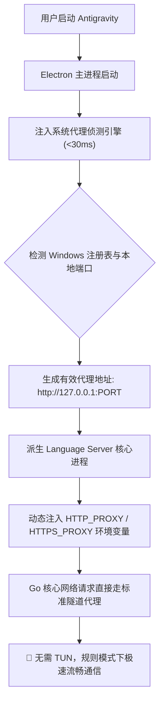

# Google Antigravity 智能代理适配与专线加速引擎 (Antigravity Proxy)

<p align="center">
  <b>突破底层 Go 核心代理限制 · 免 TUN 虚拟网卡 · 免全局模式 · 支持系统代理与规则模式 (Rule Mode)</b><br>
  专为在中国大陆网络环境下使用 Google Antigravity 的开发者打造
</p>

<p align="center">
  <a href="https://github.com/xukuncai-hub/antigravity-proxy/stargazers"></a>
  <a href="https://github.com/xukuncai-hub/antigravity-proxy/releases"></a>
  
  
  
  <a href="https://github.com/xukuncai-hub/antigravity-proxy/blob/main/LICENSE"></a>
  <a href="https://github.com/xukuncai-hub/antigravity-proxy/pulls"></a>
</p>

<p align="center">
  <a href="#-痛点剖析">痛点剖析</a> •
  <a href="#-对比优势">对比优势</a> •
  <a href="#-核心特性">核心特性</a> •
  <a href="#-快速开始">快速开始</a> •
  <a href="#-搭配推荐界面汉化">搭配界面汉化</a> •
  <a href="#-使用姿势">日常使用</a> •
  <a href="#-实现原理">实现原理</a> •
  <a href="#-一键还原">一键还原</a> •
  <a href="#-常见问题">常见问题</a>
</p>

---

> [!TIP]
> 🇨🇳 **界面中文汉化推荐**：如果您需要让 Antigravity 拥有原生级纯正中文界面（全量设置、托盘、菜单与 67 款插件、576 项扩展技能汉化），强烈推荐搭配使用我们的兄弟项目：**[Google Antigravity 中文汉化包 (antigravity-chinese)](https://github.com/xukuncai-hub/antigravity-chinese)**！

---

## 🧐 痛点剖析

许多开发者在中国大陆网络环境下使用 Google Antigravity 时，经常遇到以下困扰：
- ❌ **每次使用都必须开启“虚拟网卡 (TUN) 模式”**：普通开启代理客户端的“系统代理”完全不起作用，只要不开虚拟网卡，Antigravity 就报错断连、对话转圈；
- ❌ **每次使用都必须开启“全局 (Global) 模式”**：切换回常用的“规则模式 (Rule Mode)”后，经常提示连接失败或对话无法发出；
- ❌ **严重影响日常网络**：开了全局模式导致微信、B站、百度等国内网页极其缓慢；开启虚拟网卡还会与各类公司内网 VPN 或工控虚拟网卡（如 Siemens PLCSIM、VMware）发生严重驱动级冲突。

### 为什么会出现这个问题？

1. **底层通信核心不读取系统代理**：
   Antigravity 的核心大脑是 Go 语言编译的二进制程序 `language_server.exe`。Go 官方网络库（`net/http`）**绝不读取 Windows 注册表中的“系统代理 (WinINet)”**，它只识别 `HTTP_PROXY` / `HTTPS_PROXY` 等环境变量。因此在没有专门环境变量时，它会绕过代理直接向 Google 接口发起底层裸 TCP 直连并被网络墙阻断。过去只有开启 TUN 虚拟网卡强行劫持整机 L3 数据包才能抓取它的流量。
2. **规则模式缺乏专线分流与 DNS 污染**：
   大部分通用代理订阅规则未对 `daily-cloudcode-pa.googleapis.com`、`generativelanguage.googleapis.com`、`*.run.app`、`antigravity.google` 等接口设置专线分流规则，导致国内 DNS 解析被劫持污染，发生连接中断。

---

## 📊 对比优势

| 体验维度 | 未使用本补丁 (官方原生) | 开启整机 TUN 虚拟网卡 | 使用 Antigravity Proxy 补丁 |
| :--- | :---: | :---: | :---: |
| **代理模式要求** | 经常断连 / 无法通信 | 强制开启全局或 TUN | **只需普通系统代理 + 规则模式** |
| **国内应用网速** | 正常 | 全局模式导致严重降速卡顿 | **满速直连，毫无影响** |
| **虚拟网卡冲突** | 无 | 易与 VPN / 虚拟机 / 工控网卡冲突 | **零虚拟网卡依赖，绝不冲突** |
| **CPU / 内存开销** | 正常 | TUN 驱动转发增加 CPU 开销 | **原生直接通信，零额外损耗** |
| **专线规则与分流** | 缺失，DNS 容易被污染 | 需手动到处配置 | **自动注入专线规则与防污染** |

---

## ✨ 核心特性

- 🚀 **智能感知本地与系统代理**：以 `<30ms` 极速自动检测 Windows 代理注册表及本地常用代理端口（如 Clash Verge `7897`、Clash `7890`、v2rayN `10809` 等）；
- 🔌 **动态注入核心进程网络环境**：在 Antigravity 派生 `language_server.exe` 核心进程时精准注入标准代理环境变量，Electron 会话层自动接管，直接走标准的 HTTP CONNECT 隧道代理；
- 🛡️ **彻底摆脱 TUN 虚拟网卡**：无需安装或开启虚拟网卡驱动，不占用网络适配器，绝不与 VPN 或工业虚拟网卡冲突；
- 🌐 **完美支持“规则模式 (Rule Mode)”**：自动为 Clash Verge 注入最高优先级专线分流规则与 DNS 防污染，国内网站满速直连，开发与日常互不干扰；
- 💻 **全平台兼容与无痛还原**：自动备份原版文件，支持一键安全还原。

---

## 🚀 快速开始

### 前置要求
- 已安装 **Google Antigravity**；
- 系统已安装 **Node.js**（推荐）或 **Python 3**。

### 方式一：一键自动安装（推荐）

#### 🪟 Windows
1. 克隆或下载本项目：
```powershell
git clone https://github.com/xukuncai-hub/antigravity-proxy.git
cd antigravity-proxy
```
2. 直接**双击运行目录下的 `install.bat`** 即可一键完成全套注入与规则优化！

*也可以打开 PowerShell 执行 `.\install.ps1`。*

#### 🐧 Linux / 🍎 macOS
```bash
git clone https://github.com/xukuncai-hub/antigravity-proxy.git
cd antigravity-proxy
chmod +x install.sh
./install.sh
```

---

## 🎯 安装后的使用姿势

安装完成后，您可以直接恢复到最舒服的日常代理状态：

1. **Clash Verge / 代理客户端设置**：
   - **关闭**【TUN 模式 / 虚拟网卡】；
   - **切换为**【规则模式 (Rule)】；
   - **保持开启**【系统代理】。
2. **重启生效**：
   - 在系统托盘中彻底退出 Antigravity（右键退出）；
   - 重新打开 Antigravity，即可在规则模式和普通系统代理下享受秒级极速响应！

---

## 🇨🇳 搭配推荐：界面汉化

如果你希望将 Antigravity 的整个开发界面（包括设置中心、菜单栏、系统托盘、辅助侧边栏以及插件市场）全部汉化为纯正中文：

👉 **[Google Antigravity 中文汉化包 (antigravity-chinese)](https://github.com/xukuncai-hub/antigravity-chinese)**

- 🛡️ **物理级隔离保护**：100% 保护代码编辑器 Monaco、终端与 Prompt 输入框，绝不误翻代码；
- 🧩 **全量词库覆盖**：67 款插件、576 项扩展技能与 16 项规则全量汉化；
- 🔄 **随官方版本秒级升级**：一键脚本即可无痛适配最新版本。

---

## 📦 手动安装（免环境依赖）

如果你没有 Node.js 环境，可以直接前往 **[Releases 页面](https://github.com/xukuncai-hub/antigravity-proxy/releases)** 下载预构建的 `app.asar`，替换 Antigravity 安装目录下的 `resources/app.asar` 即可。

---

## 🔄 一键还原

如果你希望恢复为修改前的官方文件：

```bash
node install.js --restore
```
*(若安装了 Python 也可运行 `python install.py --restore`)*，或直接将 `resources/app.asar.proxy_bak` 覆盖回 `resources/app.asar`。

---

## 🛠️ 实现原理



---

## ❓ 常见问题 (FAQ)

<details>
<summary><b>Q1: 为什么安装后还是提示网络连接失败？</b></summary>
请检查以下几点：<br>
1. 确保代理软件（如 Clash Verge、v2rayN）已启动且开启了<b>「系统代理」</b>；<br>
2. 确保代理节点本身能够正常访问 Google 服务；<br>
3. 退出 Antigravity 时，请务必在<b>右下角系统托盘图标上右键选择「退出」</b>，然后再重新打开软件。
</details>

<details>
<summary><b>Q2: 这个补丁和中文汉化包冲突吗？</b></summary>
完全不冲突！两个项目都基于模块化补丁设计，可以先后安装，或者同时生效。
</details>

<details>
<summary><b>Q3: 每次 Antigravity 官方更新后需要重新执行吗？</b></summary>
是的。如果官方推送了新版本覆盖了 <code>app.asar</code>，只需重新运行一次 <code>install.bat</code> 即可再次注入生效。
</details>

---

## 🌐 English Overview

**Google Antigravity Proxy Accelerator** bypasses the native proxy limitations of Google Antigravity's Go-based `language_server` core:
- **No TUN / Virtual Network Adapter Required**: Eliminates driver-level conflicts with VPNs and corporate tools.
- **Rule Mode Friendly**: Route Google API traffic smoothly while keeping domestic websites at direct full speed.
- **Auto-Detection**: Automatically reads system proxy settings and standard local ports (Clash Verge, Clash, v2rayN) in `<30ms`.

---

## 🔍 搜索关键词 (Keywords)

`Google Antigravity 代理` · `Antigravity 加速` · `Antigravity 免TUN` · `Antigravity 规则模式` · `Antigravity Clash Verge` · `Antigravity 无法连接` · `Antigravity 提示连接失败` · `Antigravity 国内使用` · `Antigravity proxy accelerator` · `Antigravity network fix`

---

## 📄 开源许可

本项目基于 [MIT License](LICENSE) 开源。
